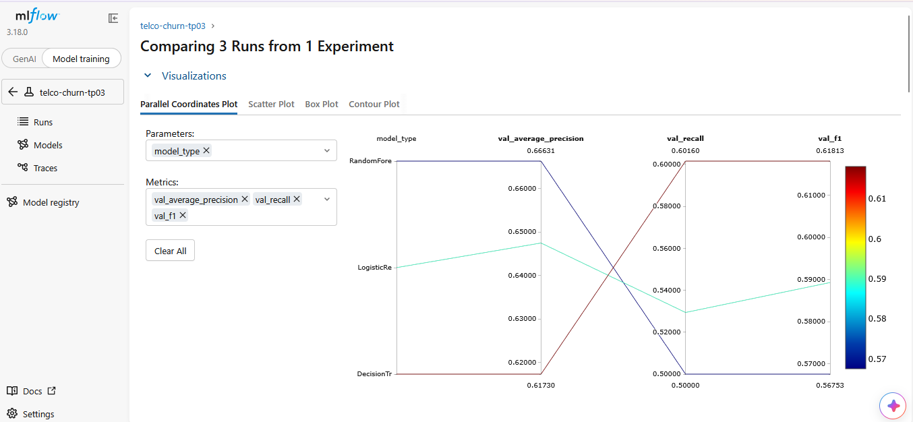
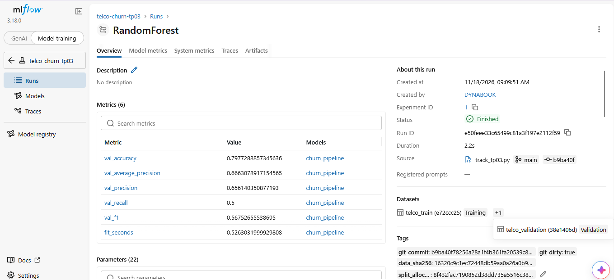
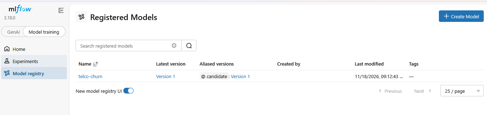

# TP03 — MLflow Experiment Tracking and Model Recovery

**Course:** ESILV — Machine Learning Operations  
**Dataset:** IBM Telco Customer Churn  
**MLflow version:** 3.18.0  
**Experiment:** `telco-churn-tp03`

## 1. Objective

The objective of TP03 is to track, compare, register, and recover machine learning models using MLflow, building on the existing TP02 churn prediction pipeline.

The experiment uses six features: `tenure`, `MonthlyCharges`, `TotalCharges`, `Contract`, `InternetService`, and `PaymentMethod`.

The positive class is `Churn = Yes (1)`. The train/validation/test allocation is preserved from TP02 (60%/20%/20%), and the test set remains reserved.

## 2. Experiment Comparison

Three models were trained and evaluated on the same validation split, using a fixed decision threshold of 0.5.

| Model | Validation AP | Recall | F1 | Decision |
|---|---:|---:|---:|---|
| Random Forest | **0.666308** | 0.500000 | 0.567527 | Selected |
| Logistic Regression | 0.647466 | 0.529412 | 0.589286 | Not selected |
| Decision Tree | 0.617300 | 0.601604 | 0.618132 | Not selected |



**Selection justification:** Random Forest was selected because it achieved the highest validation Average Precision, the primary metric defined before comparison. Decision Tree achieved better recall and F1, but changing the selection criterion after observing the results would introduce selection bias. The comparison was performed on the same validation population, without using the test set for model selection.

## 3. Selected Run and Provenance

- **Selected model:** RandomForestClassifier
- **Run ID:** `e50feee33c65499c81a3f197e2112f59`
- **Logged model URI:** `models:/m-f2c5a8cb985449528bffcef372333e5a`
- **Registered model:** `telco-churn`
- **Registered version:** `1`
- **Alias:** `candidate`
- **Git HEAD recorded during final checks:** `b9ba40f78256a28a1f4b361fa20539c8134704c1`
- **Original CSV SHA-256:** `16320c9c1ec72448db59aa0a26a0b95401046bef5d02fd3aeb906448e3055e91`

The runs record model parameters, validation metrics, Git and data identifiers, confusion matrices, provenance metadata, and training/validation dataset references.

The Git commit identifies a version of the code, while the CSV hash identifies the original dataset bytes. Neither replaces the actual source code or dataset. Customer allocation records provide additional evidence of which customers belonged to each split.



## 4. Model Registry

The selected fitted preprocessing-and-classifier pipeline was logged using `mlflow.sklearn.log_model`.

It was registered as `telco-churn`, version `1`, with the alias `candidate`.

The alias provides a convenient reference to a selected model version. It can later be reassigned without changing an already-loaded Python model object.



## 5. Model Recovery and Inference

The model was recovered in a new Python process using:

```powershell
uv run python scripts/predict_tp03.py
```

Model URI: `models:/telco-churn@candidate`

**Observed results:**

- Model successfully loaded from the registry.
- Five inference samples checked.
- Predicted classes matched the TP02 results.
- Probabilities matched within the specified tolerance of `1e-8`.
- Maximum absolute probability difference after restart: `1.1102230246251565e-16`.
- No model refitting was performed.

The prediction comparison demonstrates that the recorded fitted pipeline can be recovered without executing the training workflow again.

## 6. Persistence and Storage

The tracking server was restarted using the same local database and artifact configuration. The registered model was subsequently loaded again, and prediction agreement was verified.

**Backend store — `mlflow.db`:** Stores experiment and run metadata, parameters, metrics, tags, dataset references, and registry metadata.

**Artifact store — `mlartifacts/`:** Stores logged model files and other artifacts, including validation confusion matrices.

If only the database survives, the experiment metadata may remain accessible, but models cannot be recovered if their underlying artifact files are lost.

If only model artifact files survive, the model files may remain available, but experiment metadata, registry versions, aliases, and run relationships stored in the database would be missing.

A colleague on another machine would need access to the tracking/registry metadata and model artifacts, together with the appropriate code and compatible Python environment. Recovering the original training dataset requires a separate accessible copy; a hash alone cannot reconstruct it.

## 7. Conclusion

TP03 successfully extends the existing TP02 workflow with MLflow experiment tracking, validation-based comparison, model registration, and inference without retraining.

The selected Random Forest model is traceable through its source run and can be retrieved through the `candidate` alias. The exercise demonstrates reproducibility and local model handover, but does not constitute production deployment.
