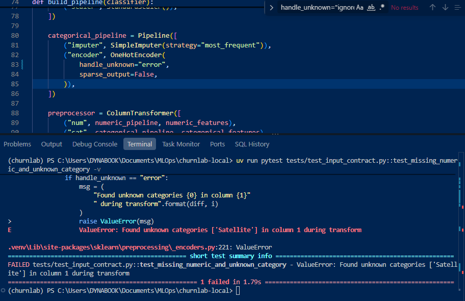
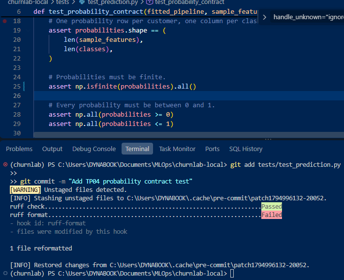

# TP04 — Testing and Code Quality for an ML Project

**Course:** ESILV — Machine Learning Operations  
**Project:** IBM Telco Customer Churn  
**Date:** November 18, 2026

## 1. Objective

The objective of TP04 is to protect the existing machine learning pipeline against regressions using automated behavioral tests, static code analysis, coverage measurement, and Git pre-commit hooks.

The existing TP02 preprocessing and training functions were reused without changing the machine learning algorithms.

## 2. Behavioral Tests

The test suite contains ten tests, including four new focused TP04 tests using 16 synthetic customers.

| Test | Behavior verified | Risk detected |
|---|---|---|
| `test_missing_required_feature_is_rejected` | Required feature validation | Missing input columns accepted |
| `test_missing_numeric_and_unknown_category` | Missing numeric values and unseen categories | Broken imputation or encoding |
| `test_probability_contract` | Probability shapes, bounds, sums and positive-class lookup | Invalid prediction probabilities |
| `test_reload_preserves_predictions` | Save/reload agreement with Joblib | Model behavior changes after serialization |

The synthetic tests do not require a network connection, the MLflow server, or the original Telco dataset.

**Test result:** 10 passed.

The existing TP02 reliability tests were retained as additional regression checks.

## 3. Regression Demonstration

A temporary behavioral regression was introduced by changing:

`OneHotEncoder(handle_unknown="ignore")`

to:

`OneHotEncoder(handle_unknown="error")`

This change breaks the documented policy allowing unknown categorical values during inference.

The relevant test was used to demonstrate detection of this regression. The implementation was then restored to `handle_unknown="ignore"`.

After restoration, the full test suite passed:

`10 passed`



## 4. Ruff Code Quality

Tools:

- Ruff version: `0.17.5`
- Python version: `3.12.7`

Initial analysis detected two import-order issues and seven files requiring formatting.

The issues were corrected using:

```powershell
uv run ruff check --fix src/churnlab tests
uv run ruff format src/churnlab tests
```

Final results:

- Ruff lint: **All checks passed**
- Ruff formatting: **8 files already formatted**
- Pytest after formatting: **10 passed**

Formatting changes were checked without intentionally modifying model behavior.

## 5. Test Coverage

Coverage was measured with:

```powershell
uv run pytest --cov=churnlab --cov-report=term-missing --cov-report=xml:coverage.xml
```

| Source file | Coverage |
|---|---:|
| `features.py` | 100% |
| `training.py` | 54% |
| `__init__.py` | 50% |
| **Total** | **67%** |

The tests executed 46 of 69 measured statements.

**Identified coverage gap:** The dataset loading and integrity-validation logic in `training.py` is not fully covered.

**Proposed additional test:** Create a temporary CSV with an incorrect SHA-256 checksum and assert that `load_dataset()` raises `ValueError("Dataset SHA-256 mismatch")`.

Coverage shows which statements were executed. It does not prove that every behavior was correctly asserted, nor that the machine learning model is accurate or fair.

## 6. Pre-commit Hooks

Pre-commit version: `4.7.0`.

The project uses a pinned Ruff hook configuration in `.pre-commit-config.yaml`:

- `ruff-check`
- `ruff-format`
- Ruff version `v0.17.5`

The hooks were installed and validated using:

```powershell
uv run pre-commit validate-config
uv run pre-commit install
uv run pre-commit run --all-files
```

Both hooks passed the initial full-file check.

### Blocked commit demonstration

A formatting defect was deliberately introduced into `tests/test_prediction.py`.

The first commit attempt was blocked:

`ruff format — Failed: files were modified by this hook`

Ruff automatically corrected the file. After reviewing and staging the correction, the second commit attempt succeeded.

**Successful commit:** `efba4c8`



The full pytest suite was executed again after the successful commit, with ten passing tests.

## 7. Quality Gates and Limitations

Behavioral tests verify expected input/output behavior and can detect selected regressions.

Ruff detects static issues and enforces formatting consistency.

Coverage reports executed statements and helps identify untested code, but high coverage does not imply correctness.

A Quality Gate evaluates results against configured policies. Passing a Quality Gate does not guarantee that a model is useful, fair, secure, or accurate.

Local pre-commit hooks can be bypassed. They should therefore be complemented by mandatory CI checks.

SonarQube Community Build was considered as an optional extension; no local SonarQube analysis is claimed in this report.

## 8. Conclusion

TP04 added four independent synthetic-data tests and retained six existing reliability tests.

The final suite passed all ten tests. Ruff lint and formatting checks passed, coverage reached 67%, and pre-commit successfully demonstrated both a blocked commit and an accepted retry.

These checks establish a local quality-control foundation that can be reused in TP05 with GitHub Actions.